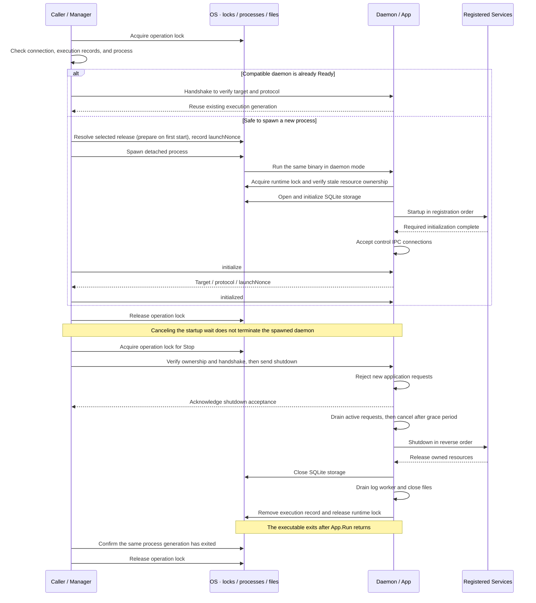
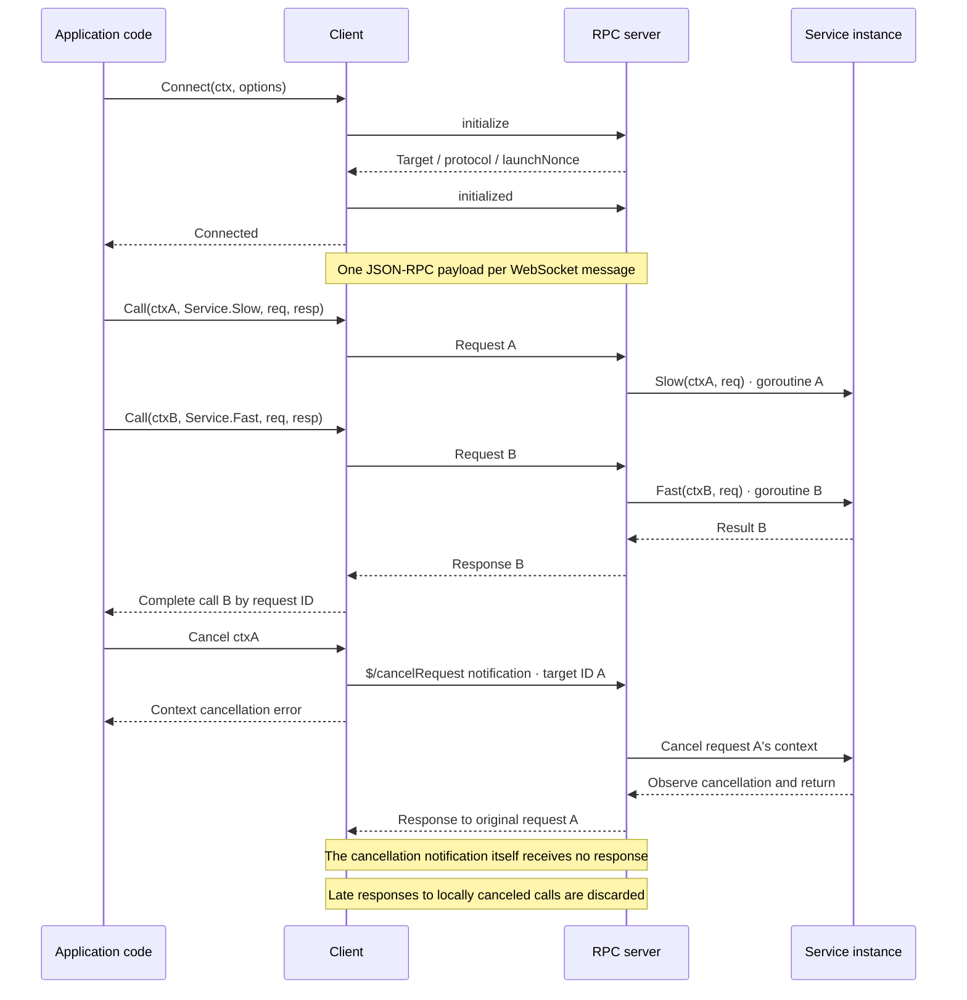

# go-daemonkit

A framework for running Go services as user-local daemons.
The framework manages processes, ownership, lifecycle, and local RPC. Services own business logic and their resources.

Try the [interactive update demo](examples/update-demo/README.md) to switch between
three local daemon builds and call version-specific RPCs.

These three diagrams describe the current implementation.

## 1. Components and responsibilities

The CLI and daemon use the same binary in different execution modes. GUI applications can use the same Client API.


| Component | Responsibility | Code |
| --- | --- | --- |
| Manager | Serialize lifecycle operations; select releases; verify updates and recover interrupted transitions | [manager.go](manager.go), [stop.go](stop.go), [update.go](update.go), [release.go](release.go) |
| App | Validate services, hold the runtime lock, order initialization and cleanup | [app.go](app.go), [service.go](service.go) |
| Client / RPC server | Match request IDs, encode results and errors, manage concurrency, cancellation, and limits | [client.go](client.go), [method.go](method.go), [rpc_server.go](rpc_server.go) |
| Events | Exact-topic subscriptions, ordered delivery, bounded queues and cleanup | [events.go](events.go), [events_server.go](events_server.go) |
| Transport / execution ownership | Enforce OS-user access, establish local connections, verify process identity and execution generation | [transport.go](transport.go), [execution.go](execution.go) |
| Storage | App-owned SQLite lifetime, namespace isolation, snapshots and atomic writes | [storage](storage/) · [lifetime](storage.go) |
| Application Service | Enforce business rules, protect shared state, observe cancellation, create and release its resources | [ClockService example](examples/update-demo/clock.go) |

Register a Service as a pointer to a named struct for lifecycle management only.
`Startup(context.Context) error` and `Shutdown(context.Context) error` are independently optional.
Other service methods are unrestricted and are not exposed automatically.

Declare public DTOs and a stable RPC name in a shared contract package:

```go
var Now = daemon.NewMethod[NowRequest, NowResponse]("clock.now")
```

Expose a handler explicitly and invoke the same contract from a client:

```go
if err := app.Register(service); err != nil {
    return err
}
if err := app.Handle(clockapi.Now, service.Now); err != nil {
    return err
}
result, err := client.Invoke(ctx, clockapi.Now, clockapi.NowRequest{})
```

`Handle` accepts `func(context.Context, Request) (Response, error)`; generic type
inference checks its signature against the contract. Request and Response must be
named struct values, and may be reused across operations. Handlers can be free
functions or closures without a registered lifecycle participant.

RPC names are independent of Go package, type, and implementation method names.
Duplicate names, nil handlers, and registration after Run begins are rejected.
`initialize`, `initialized`, `shutdown`, and the `$/` and `rpc.` prefixes are reserved.
`Invoke` returns a zero response on error. The raw `Call` API remains available.
Handlers may run concurrently and must observe cancellation. Applications own DTO
semantics and JSON field compatibility; the framework does not negotiate schemas.

See the separate [clock contract](examples/update-demo/api/api.go) and
[service implementation](examples/update-demo/clock.go). No generator is required.

## 2. Process lifecycle and OS boundaries

The operation lock protects **one control operation**. The runtime lock protects **the entire App.Run lifetime**.
Both are scoped to an application and instance.



A live daemon that is not yet Ready is awaited. Protocol mismatches and unverifiable ownership produce errors.
If Startup fails, previously started Services are shut down in reverse order; the failing hook owns its partial cleanup.
Restart holds one operation lock from shutdown through the next successful readiness handshake.

| OS-dependent area | Linux | macOS | Windows |
| --- | --- | --- | --- |
| State root | `XDG_STATE_HOME`, default `~/.local/state` | Same as Linux | `LOCALAPPDATA` |
| Local transport | UDS | UDS | Named Pipe |
| Access control | User-owned directory `0700`, socket `0600` | Same as Linux | Current-user SID DACL; remote connections rejected |
| Locking | `flock` | `flock` | Named mutex object existence acts as the ownership lease |
| Detached execution | `setsid` | `setsid` | Detached / process group / job breakaway flags |
| Process identity | Boot ID + `/proc` start time | Boot session UUID + `sysctl` start time | Process creation time |
| Forced termination | Pin the target with pidfd, then SIGKILL | Unsupported; returns a timeout error | Terminate through a verified process handle |

Instance state lives at `<state root>/<appID>/<instanceID>`. Executables are stored at
`releases/<content hash>/<appID>d`, with an `.exe` suffix on Windows.
Running executables are never overwritten. Records, logs, and the working directory live outside releases.

### Inspecting a daemon

`Manager.Status(ctx)` returns a snapshot without starting, stopping, recovering,
or modifying instance files:

```go
status, err := manager.Status(ctx)
fmt.Println(status.State, status.Version, status.PID)
fmt.Println(status.StateDir, status.LogPath, status.Endpoint)
fmt.Println(status.StdoutPath, status.StderrPath)
if err != nil {
    // The snapshot still contains paths and any verified process information.
    return err
}
```

The snapshot includes application and instance IDs, managed release hash, and the
negotiated protocol version. Version and protocol are populated after a successful
handshake. LogPath points to managed application logs; StdoutPath and StderrPath
identify separate raw-output files. They may not exist before the first run.
Foreground execution leaves the process's standard streams unchanged.

| State | Observation |
| --- | --- |
| `ready` | A compatible handshake matched a live execution record |
| `running` | A recorded process generation is alive, but readiness could not be confirmed |
| `stopped` | No live recorded process and the local endpoint was absent or refused connection |
| `unknown` | Inspection could not establish the state |

Connection, permission, protocol, malformed record, and cancellation errors
return partial information alongside the error. A failed connection alone does
not mean stopped. This is an observation, not a lifecycle lock: a concurrent
launch may not have published its process record yet, and the state can change
immediately after the query.

### Updating a managed daemon

`manager.Update(ctx, executablePath)` copies a prepared local executable into managed
storage and selects it with the Manager's configured daemon arguments. The caller
owns downloading and verifying authenticity, integrity, and the requested version.
Keep the source unchanged until Update returns; it can then be removed. An existing
CLI or GUI can update the daemon without first running the new executable as a CLI.
The calling CLI itself is not replaced.
An identical content hash is a no-op. With no running daemon, it selects the release
without starting it. Otherwise, it stops the old process, starts the candidate,
verifies Ready, and commits the selection. `EnsureRunning` and `Restart` use the
selected release and its saved arguments, even when called by a different CLI build.

On candidate failure, the previous release is restarted. `errors.Is(err,
daemon.ErrUpdateRolledBack)` means that rollback reached Ready; it still reports a
failed update. Application data is not rolled back. Failed rollback or unverifiable
process ownership leaves the journal in place and returns an error.

Cancellation after shutdown begins ends the caller's wait. The next lifecycle
call resumes the persisted transaction; `Stop` instead records a stop request and
converges to a stopped instance without launching a replacement. There is no
background updater. See [the update implementation](update.go).

## 3. RPC calls, concurrency, and cancellation

`Connect` connects to an existing daemon. It does not start one; callers can invoke `EnsureRunning` first when needed.
Connections are restricted to the same OS user. Each handshake verifies the application, instance, and protocol version.



- Multiple calls share one connection. Responses may arrive out of request order.
- Cancellation is cooperative. It does not guarantee rollback or forcibly terminate goroutines.
- Disconnection fails pending calls on that connection and cancels their server-side contexts. Mutating requests are never automatically replayed.
- Messages are limited to 64 KiB. Each Client allows up to 64 pending calls; the server allows up to 64 active requests across all connections.
- Errors carry `code`, `message`, and optional `data`. Programs should branch on codes and structured data, not message strings.
- Cancellation adopts LSP's `$/cancelRequest` and `-32800` as extensions. Overload `-32001` and shutdown rejection `-32600` with `data.reason` follow Codex conventions. These are framework contracts, not a claim of full LSP compliance.

### Logging

The framework owns log files, asynchronous writing, rotation, and cleanup.
Applications choose their logger and output format. Obtain the writer before Run
and inject a logger into services; the writer is active from Startup through
the last Shutdown hook.

```go
// Using github.com/rs/zerolog in your application:
logger := zerolog.New(app.LogWriter()).With().Timestamp().Logger()
logger.Info().Str("workspace", path).Msg("opened")
```

The standard library also works: `log.New(app.LogWriter(), "", log.LstdFlags)`.

Each Write copies one opaque byte record, at most 64 KiB. At most 256 records
can be outstanding, including concurrent copies and the in-flight disk write.
Calls never wait for disk I/O, rotation, or queue space. Memory synchronization,
allocation, and logger formatting still take time. Oversized writes and writes
to a full queue are discarded whole and return `len(p), nil`; writes before
Run or after Shutdown return `os.ErrClosed`. Acceptance does not imply storage.

One worker serializes writes and rotates before exceeding 10 MiB, retaining
three previous files. I/O failures discard that record without replay; the next
record can try again. Failed rotation prevents appending past the limit. Loss
and failure counts are kept in memory, without recursive logging. No per-record
fsync, durable audit logging, or automatic flushing of caller-owned buffers is
provided.

Files live under `<state>/<app>/<instance>/logs/`:

| File | Contents and retention |
| --- | --- |
| `daemon.log` | LogWriter output; 10 MiB plus `.1`, `.2`, `.3` |
| `daemon.stdout` | Managed child stdout; periodically trimmed |
| `daemon.stderr` | Managed child stderr, panic output, and framework diagnostics; periodically trimmed |

Framework text is kept out of daemon.log so application JSONL remains JSONL.
Every 30 seconds, even without managed writes, the worker checks raw files.
Above 10 MiB, it preserves the last 1 MiB in `.previous`, then truncates the
original file in place. Failed preservation leaves the original intact.
Inherited handles use append mode. Raw output can block on disk, can be lost
during concurrent truncation, and can exceed the threshold between checks.
Raw capture applies to Manager-launched processes; foreground stdout/stderr
are not redirected. Files are private to the OS user.

After Service Shutdown, admission closes and Run waits up to two seconds for
draining and file cleanup. On timeout, pending writes are abandoned and
`errors.Is(err, daemon.ErrLogShutdownTimeout)` is true. A stuck OS write or Close
cannot be canceled: the runtime lock, execution record, and App running state
remain owned until cleanup finishes or the process exits. Another Run cannot
reuse that instance during this time. Manager.Stop recognizes the closing
execution and includes the logging budget in its shutdown wait.

Daemon entry points should exit after Run returns. Flush any application-owned
buffers in Shutdown. Abrupt process exit and cleanup timeout can lose accepted
logs. The two-second limit bounds logging cleanup, not arbitrary service hooks,
initial file opening, or other startup work.

### Storage

The App owns the database lifetime. Inject a namespace handle into each service;
handles have no Close method. Use View or Update when several operations must
share a transaction.

```go
store, err := app.Storage("workspace")
if err != nil {
    return err
}
// Inside Startup, an RPC method, or Shutdown:
err = storage.SetJSON(ctx, store, "preferences", Preferences{Theme: "dark"})
prefs, err := storage.GetJSON[Preferences](ctx, store, "preferences")
```

Import `github.com/134130/go-daemonkit/storage` for Store, transaction types,
errors, and JSON helpers. Store also provides Get, Set, Delete, and List for raw
bytes. JSON helpers use encoding/json; a missing key returns storage.ErrNotFound.

### Secrets

Use `app.Secrets("oauth")` to obtain a `*secrets.Store` and inject it into a
service. Get, Set, and Delete accept a context; values are opaque bytes, limited
to 2,560 bytes. The OS owns the store, so handles do not require App.Run and have
no Close method. Read required credentials in Startup to make access failures
prevent readiness.

Secrets use macOS Keychain (requires cgo), Linux Secret Service over the session
D-Bus, or Windows Credential Manager. There is no plaintext file fallback.
Native calls may prompt or block and cannot be interrupted by context cancellation.

This protects stored credentials according to OS policy. It does not guarantee
biometric authentication or protection from process memory inspection. Scope
names and keys are metadata; namespace isolation is not an authorization boundary
against other processes running as the same user. See [the secrets API](secrets/secrets.go).

### Events

Declare `clockapi.Tick = daemon.NewTopic[NowResponse]("clock.tick")` in the shared
contract package. Publish with `app.PublishTopic(clockapi.Tick, tick)`. Inject the publish
function into a service; it does not need to hold the App. Publish is available
during Startup through Shutdown, succeeds with no subscribers, and does not wait
for consumers.

```go
sub, err := client.SubscribeTopic(ctx, clockapi.Tick)
if err != nil {
    return err
}
defer sub.Close()

for {
    tick, err := sub.Next(ctx)
    if err != nil {
        return err
    }
    fmt.Println(tick.Time)
}
```

SubscribeTopic's context bounds registration; Next's context bounds one read.
Canceling either does not cancel other calls. Next consumes one event and decodes
it; call Next sequentially. Errors return a zero payload; JSON decode failures
consume the event but leave the subscription active. Close is idempotent and sends an
unsubscribe notification without waiting for acknowledgment.

The raw `Publish`, `Subscribe`, and `Subscription.Next(ctx, dst)` APIs remain available.
Typed contracts reuse the same wire protocol and queues; payload schema compatibility
belongs to the application. Payloads may be any JSON-serializable value.

Subscriptions receive events from server registration onward, including events
queued while its reply is in flight; earlier events are not replayed. Each
subscription preserves publication order, including concurrent publishes as
serialized by the server. Topic names are exact, case-sensitive identifiers of
at most 64 characters (letters, digits, dot, underscore and hyphen).

Both ends buffer at most 16 events per subscription. Overflow discards queued
events and terminates that subscription with ErrEventOverflow. Each connection
allows 32 subscriptions; the server allows 256 active subscription workers.
Messages retain the 64 KiB limit. The shared reader never waits for event
consumers. A socket write failure or timeout closes the connection, affecting
its RPC calls and other subscriptions too. An unsubscribe write failure also
closes the connection so the server can reclaim registrations.

There is no replay, automatic resubscription, wildcard matching, or progress API.
After reconnecting, callers explicitly subscribe again. In the
[update demo](examples/update-demo/README.md), press `w` to subscribe and receive
the next clock event, published every five seconds.

### Conditional updates

Use `Status.UpdateToken` with `Manager.UpdateIf(ctx, executablePath, token)` when
an application's version policy depends on an observed daemon. Tokens are valid
only for Ready managed executions; they bind the instance, execution generation,
and selected invocation. They are opaque Go values, not serializable credentials.
A restart invalidates the token even if the binary version stays the same.

`ErrUpdateConflict` means the condition changed or a launch, stop, or update
journal is pending. No new update or recovery is started on conflict. Re-observe
and reconsider policy; use the existing lifecycle operations for pending recovery.
Do not blindly retry with a new token. Version ordering remains application-owned.
After acceptance, cancellation and rollback have the same semantics as `Update`.
A same-binary update remains a no-op and does not change daemon arguments.

### Child environments

`NewManager` inherits the caller's environment at each spawn. To avoid changing
process-wide environment variables, use an explicit child environment:

```go
manager, err := daemon.NewManagerWithLaunch(options, daemon.LaunchOptions{
    Env: childEnv, // Complete environment selected by the application.
}, "daemon", "run", "--config", activePath)
```

The constructor copies Env. Nil inherits; an empty non-nil slice disables
inheritance. Go may add required platform variables (SYSTEMROOT on Windows).
Duplicate keys follow `exec.Cmd.Env` rules; the framework overrides its launch
nonce. Build an allowlisted environment when inherited credentials are unwanted.

The environment applies to every child this Manager starts, including rollback.
It is never stored in selections or journals. Recovery by another Manager uses
that Manager's environment: launcher crashes do not preserve transient secrets or
environment-only configuration. Store non-secret invocation identity in argv;
applications must distinguish optional default configuration from required files.
Old environment-only selections cannot reconstruct an environment never recorded.

### Connection lifetime

`Client.Done()` closes when its receive loop exits; `Client.Err()` returns the
first connection failure. Local Close reports `ErrClientClosed` unless an earlier
transport error already exists. Multiple observers can wait on Done. This detects
observed disconnection, not silent network failure or daemon health.

Applications own reconnection, client replacement, UI epochs, and disposal of
connections completed after UI shutdown. Calls are never automatically replayed.
Protocol compatibility does not imply application-method availability: an
unregistered method returns `*RPCError` with code `-32601` (method not found).
