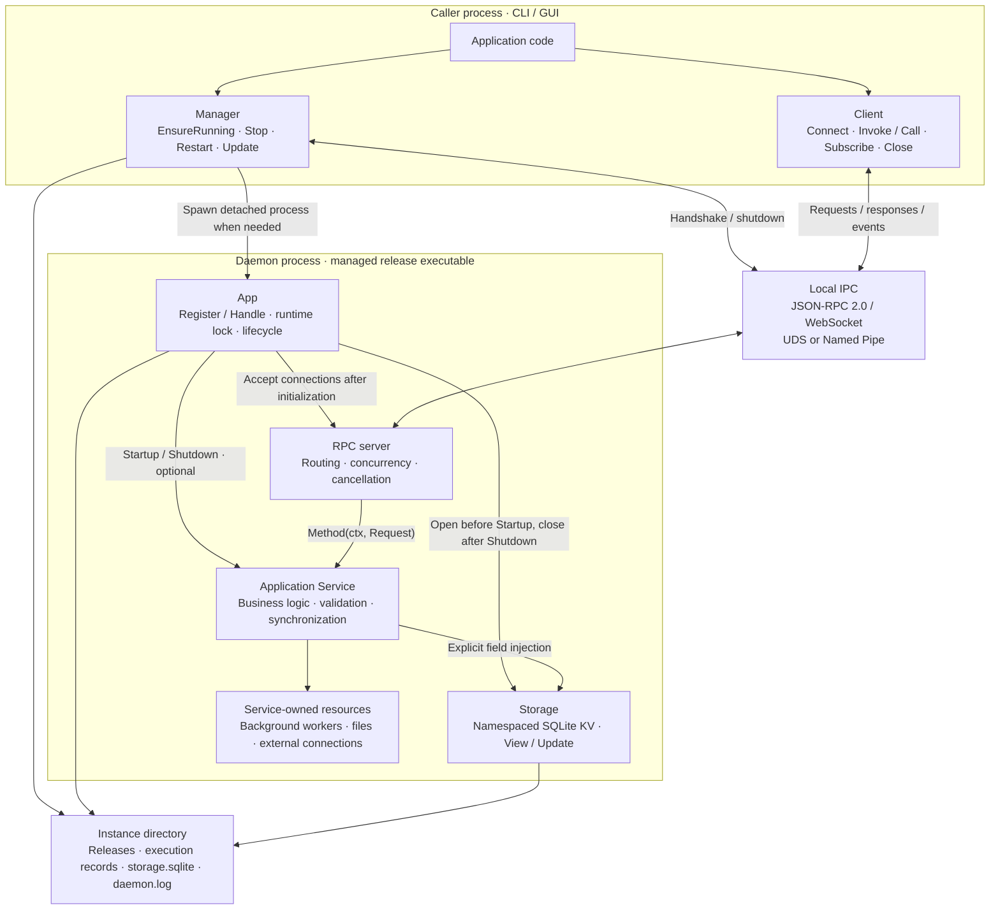
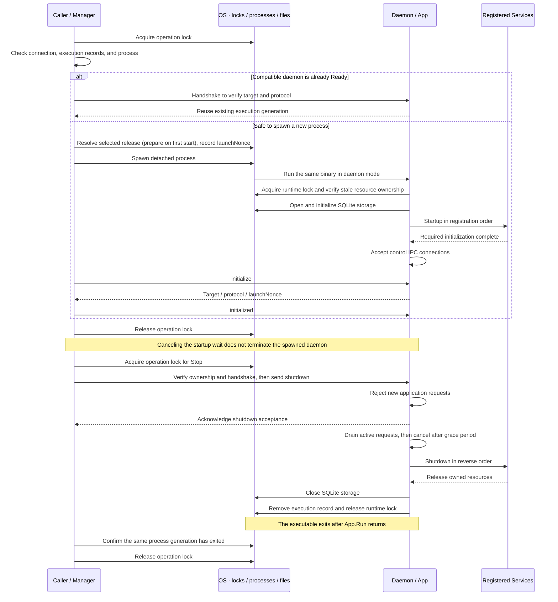
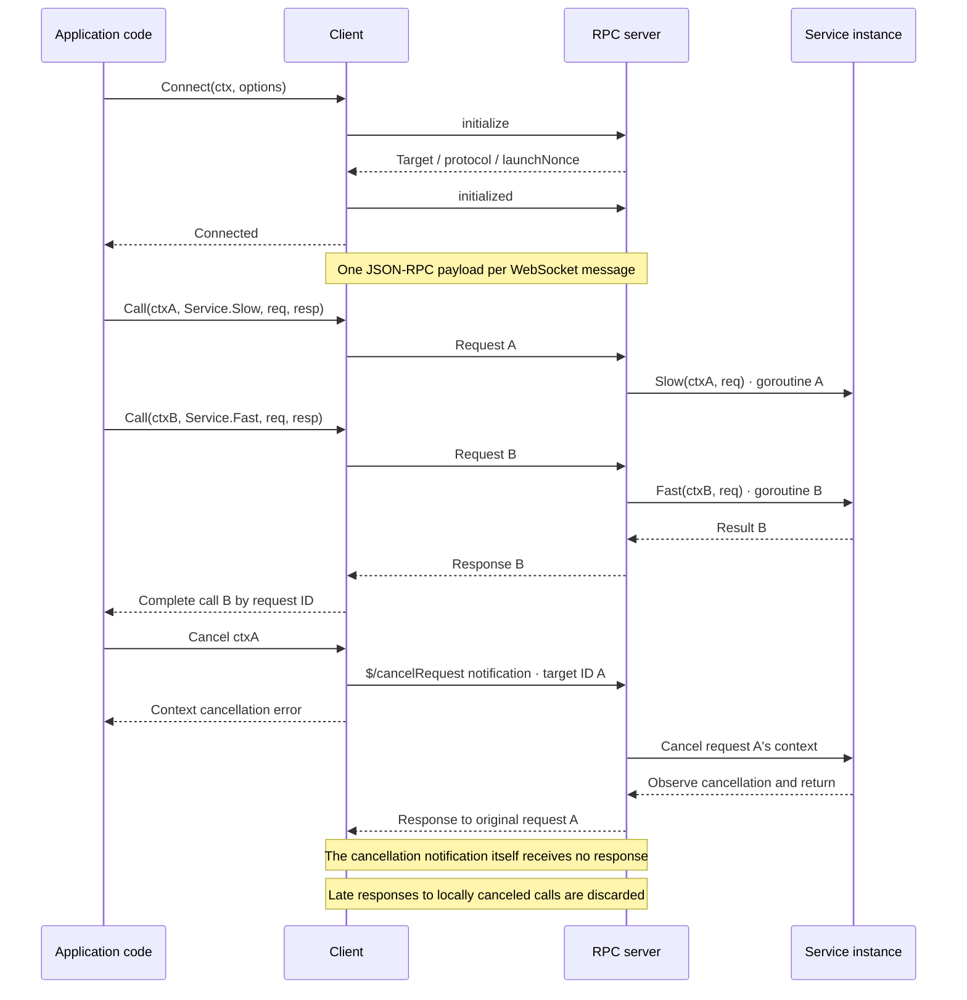

# go-daemonkit

A framework for running Go services as user-local daemons.
The framework manages processes, ownership, lifecycle, and local RPC. Services own business logic and their resources.

These three diagrams describe the current implementation.

## 1. Components and responsibilities

The CLI and daemon use the same binary in different execution modes. GUI applications can use the same Client API.



| Component | Responsibility | Code |
| --- | --- | --- |
| Manager | Serialize lifecycle operations; select releases; verify updates and recover interrupted transitions | [manager.go](manager.go), [stop.go](stop.go), [update.go](update.go), [release.go](release.go) |
| App | Validate services, hold the runtime lock, order initialization and cleanup | [app.go](app.go), [service.go](service.go) |
| Client / RPC server | Match request IDs, encode results and errors, manage concurrency, cancellation, and limits | [client.go](client.go), [method.go](method.go), [rpc_server.go](rpc_server.go) |
| Events | Exact-topic subscriptions, ordered delivery, bounded queues and cleanup | [events.go](events.go), [events_server.go](events_server.go) |
| Transport / execution ownership | Enforce OS-user access, establish local connections, verify process identity and execution generation | [transport.go](transport.go), [execution.go](execution.go) |
| Storage | App-owned SQLite lifetime, namespace isolation, snapshots and atomic writes | [storage](storage/) · [lifetime](storage.go) |
| Application Service | Enforce business rules, protect shared state, observe cancellation, create and release its resources | [ClockService example](examples/foreground/clock.go) |

Register a Service as a pointer to a named struct for lifecycle management only.
`Startup(context.Context) error` and `Shutdown(context.Context) error` are independently optional.
Other service methods are unrestricted and are not exposed automatically.

Declare public DTOs and a stable RPC name in a shared contract package:

```go
var Now = daemon.NewMethod[NowRequest, NowResponse]("clock.now")
```

Expose a handler explicitly and invoke the same contract from a client:

```go
if err := app.Register(service); err != nil {
    return err
}
if err := app.Handle(clockapi.Now, service.Now); err != nil {
    return err
}
result, err := client.Invoke(ctx, clockapi.Now, clockapi.NowRequest{})
```

`Handle` accepts `func(context.Context, Request) (Response, error)`; generic type
inference checks its signature against the contract. Request and Response must be
named struct values, and may be reused across operations. Handlers can be free
functions or closures without a registered lifecycle participant.

RPC names are independent of Go package, type, and implementation method names.
Duplicate names, nil handlers, and registration after Run begins are rejected.
`initialize`, `initialized`, `shutdown`, and the `$/` and `rpc.` prefixes are reserved.
`Invoke` returns a zero response on error. The raw `Call` API remains available.
Handlers may run concurrently and must observe cancellation. Applications own DTO
semantics and JSON field compatibility; the framework does not negotiate schemas.

See the separate [clock contract](examples/foreground/clockapi/clock.go) and
[service implementation](examples/foreground/clock.go). No generator is required.

## 2. Process lifecycle and OS boundaries

The operation lock protects **one control operation**. The runtime lock protects **the entire App.Run lifetime**.
Both are scoped to an application and instance.



A live daemon that is not yet Ready is awaited. Protocol mismatches and unverifiable ownership produce errors.
If Startup fails, previously started Services are shut down in reverse order; the failing hook owns its partial cleanup.
Restart holds one operation lock from shutdown through the next successful readiness handshake.

| OS-dependent area | Linux | macOS | Windows |
| --- | --- | --- | --- |
| State root | `XDG_STATE_HOME`, default `~/.local/state` | Same as Linux | `LOCALAPPDATA` |
| Local transport | UDS | UDS | Named Pipe |
| Access control | User-owned directory `0700`, socket `0600` | Same as Linux | Current-user SID DACL; remote connections rejected |
| Locking | `flock` | `flock` | Named mutex object existence acts as the ownership lease |
| Detached execution | `setsid` | `setsid` | Detached / process group / job breakaway flags |
| Process identity | Boot ID + `/proc` start time | Boot session UUID + `sysctl` start time | Process creation time |
| Forced termination | Pin the target with pidfd, then SIGKILL | Unsupported; returns a timeout error | Terminate through a verified process handle |

Instance state lives at `<state root>/<appID>/<instanceID>`. Executables are stored at
`releases/<content hash>/<appID>d`, with an `.exe` suffix on Windows.
Running executables are never overwritten. Records, logs, and the working directory live outside releases.

### Updating a managed daemon

`manager.Update(ctx, executablePath)` copies a prepared local executable into managed
storage and selects it with the Manager's configured daemon arguments. The caller
owns downloading and verifying authenticity, integrity, and the requested version.
Keep the source unchanged until Update returns; it can then be removed. An existing
CLI or GUI can update the daemon without first running the new executable as a CLI.
The calling CLI itself is not replaced.
An identical content hash is a no-op. With no running daemon, it selects the release
without starting it. Otherwise, it stops the old process, starts the candidate,
verifies Ready, and commits the selection. `EnsureRunning` and `Restart` use the
selected release and its saved arguments, even when called by a different CLI build.

On candidate failure, the previous release is restarted. `errors.Is(err,
daemon.ErrUpdateRolledBack)` means that rollback reached Ready; it still reports a
failed update. Application data is not rolled back. Failed rollback or unverifiable
process ownership leaves the journal in place and returns an error.

Cancellation after shutdown begins ends the caller's wait. The next lifecycle
call resumes the persisted transaction; `Stop` instead records a stop request and
converges to a stopped instance without launching a replacement. There is no
background updater. See [the update state machine](doc/02_process_update.md).

## 3. RPC calls, concurrency, and cancellation

`Connect` connects to an existing daemon. It does not start one; callers can invoke `EnsureRunning` first when needed.
Connections are restricted to the same OS user. Each handshake verifies the application, instance, and protocol version.



- Multiple calls share one connection. Responses may arrive out of request order.
- Cancellation is cooperative. It does not guarantee rollback or forcibly terminate goroutines.
- Disconnection fails pending calls on that connection and cancels their server-side contexts. Mutating requests are never automatically replayed.
- Messages are limited to 64 KiB. Each Client allows up to 64 pending calls; the server allows up to 64 active requests across all connections.
- Errors carry `code`, `message`, and optional `data`. Programs should branch on codes and structured data, not message strings.
- Cancellation adopts LSP's `$/cancelRequest` and `-32800` as extensions. Overload `-32001` and shutdown rejection `-32600` with `data.reason` follow Codex conventions. These are framework contracts, not a claim of full LSP compliance.

### Storage

The App owns the database lifetime. Inject a namespace handle into each service;
handles have no Close method. Use View or Update when several operations must
share a transaction.

```go
store, err := app.Storage("workspace")
if err != nil {
    return err
}
// Inside Startup, an RPC method, or Shutdown:
err = storage.SetJSON(ctx, store, "preferences", Preferences{Theme: "dark"})
prefs, err := storage.GetJSON[Preferences](ctx, store, "preferences")
```

Import `github.com/134130/go-daemonkit/storage` for Store, transaction types,
errors, and JSON helpers. Store also provides Get, Set, Delete, and List for raw
bytes. JSON helpers use encoding/json; a missing key returns storage.ErrNotFound.

### Secrets

Use `app.Secrets("oauth")` to obtain a `*secrets.Store` and inject it into a
service. Get, Set, and Delete accept a context; values are opaque bytes, limited
to 2,560 bytes. The OS owns the store, so handles do not require App.Run and have
no Close method. Read required credentials in Startup to make access failures
prevent readiness.

Secrets use macOS Keychain (requires cgo), Linux Secret Service over the session
D-Bus, or Windows Credential Manager. There is no plaintext file fallback.
Native calls may prompt or block and cannot be interrupted by context cancellation.

This protects stored credentials according to OS policy. It does not guarantee
biometric authentication or protection from process memory inspection. Scope
names and keys are metadata; namespace isolation is not an authorization boundary
against other processes running as the same user. See [the API](secrets/secrets.go)
and [storage contract](doc/05_storage.md).

### Events

Publish JSON values with `app.Publish("clock.tick", tick)`. Inject the publish
function into a service; it does not need to hold the App. Publish is available
during Startup through Shutdown, succeeds with no subscribers, and does not wait
for consumers.

```go
sub, err := client.Subscribe(ctx, "clock.tick")
if err != nil {
    return err
}
defer sub.Close()

for {
    var tick NowResponse
    if err := sub.Next(ctx, &tick); err != nil {
        return err
    }
    fmt.Println(tick.Time)
}
```

Subscribe's context bounds registration; Next's context bounds one read.
Canceling either does not cancel other calls. Next consumes one event and decodes
it, like Call; call Next sequentially. Invalid destination pointers do not consume
an event, while JSON decode failures do. Close is idempotent and sends an
unsubscribe notification without waiting for acknowledgment.

Subscriptions receive events from server registration onward, including events
queued while its reply is in flight; earlier events are not replayed. Each
subscription preserves publication order, including concurrent publishes as
serialized by the server. Topic names are exact, case-sensitive identifiers of
at most 64 characters (letters, digits, dot, underscore and hyphen).

Both ends buffer at most 16 events per subscription. Overflow discards queued
events and terminates that subscription with ErrEventOverflow. Each connection
allows 32 subscriptions; the server allows 256 active subscription workers.
Messages retain the 64 KiB limit. The shared reader never waits for event
consumers. A socket write failure or timeout closes the connection, affecting
its RPC calls and other subscriptions too. An unsubscribe write failure also
closes the connection so the server can reclaim registrations.

There is no replay, automatic resubscription, wildcard matching, or progress API.
After reconnecting, callers explicitly subscribe again. Try `foreground watch`
with the foreground example running to receive a clock event every five seconds.
