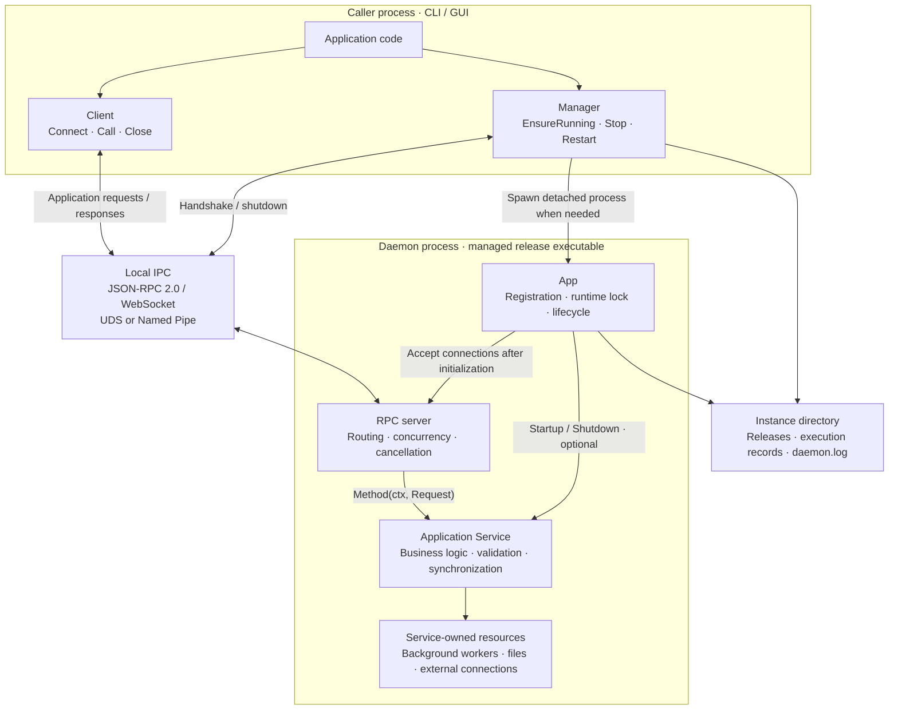
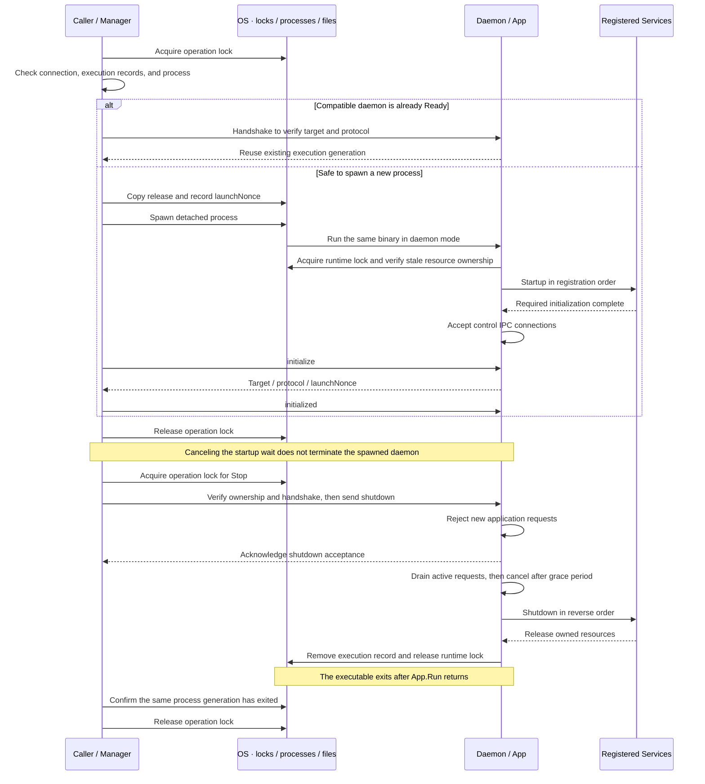
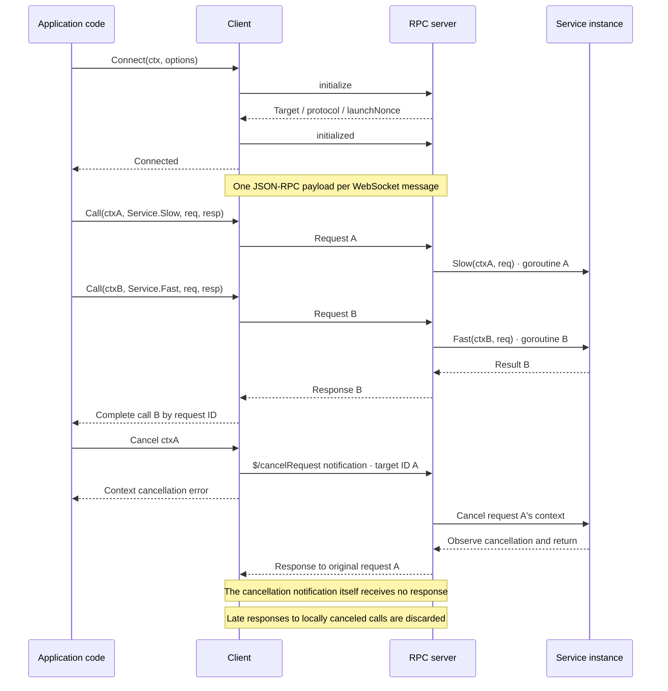

# go-daemonkit

A framework for running Go services as user-local daemons.
The framework manages processes, ownership, lifecycle, and local RPC. Services own business logic and their resources.

These three diagrams describe the current implementation.

## 1. Components and responsibilities

The CLI and daemon use the same binary in different execution modes. GUI applications can use the same Client API.

| Component | Responsibility | Code |
| --- | --- | --- |
| Manager | Serialize start, stop, and restart; prepare releases; confirm readiness and process exit | [manager.go](manager.go), [stop.go](stop.go), [release.go](release.go) |
| App | Validate services, hold the runtime lock, order initialization and cleanup | [app.go](app.go), [service.go](service.go) |
| Client / RPC server | Match request IDs, encode results and errors, manage concurrency, cancellation, and limits | [client.go](client.go), [rpc_server.go](rpc_server.go) |
| Transport / execution ownership | Enforce OS-user access, establish local connections, verify process identity and execution generation | [transport.go](transport.go), [execution.go](execution.go) |
| Application Service | Enforce business rules, protect shared state, observe cancellation, create and release its resources | [ClockService example](examples/foreground/clock.go) |

Register a Service as a pointer to a named struct. Exported application methods use
`Method(context.Context, Request) (Response, error)`, where Request and Response are named struct values.
`Startup(context.Context) error` and `Shutdown(context.Context) error` are independently optional hooks, never RPC methods.
The framework shares each Service instance across requests, so its methods may run concurrently.

## 2. Process lifecycle and OS boundaries

The operation lock protects **one control operation**. The runtime lock protects **the entire App.Run lifetime**.
Both are scoped to an application and instance.

A live daemon that is not yet Ready is awaited. Protocol mismatches and unverifiable ownership produce errors.
If Startup fails, previously started Services are shut down in reverse order; the failing hook owns its partial cleanup.
Restart holds one operation lock from shutdown through the next successful readiness handshake.

| OS-dependent area | Linux | macOS | Windows |
| --- | --- | --- | --- |
| State root | `XDG_STATE_HOME`, default `~/.local/state` | Same as Linux | `LOCALAPPDATA` |
| Local transport | UDS | UDS | Named Pipe |
| Access control | User-owned directory `0700`, socket `0600` | Same as Linux | Current-user SID DACL; remote connections rejected |
| Locking | `flock` | `flock` | Named mutex object existence acts as the ownership lease |
| Detached execution | `setsid` | `setsid` | Detached / process group / job breakaway flags |
| Process identity | Boot ID + `/proc` start time | Boot session UUID + `sysctl` start time | Process creation time |
| Forced termination | Pin the target with pidfd, then SIGKILL | Unsupported; returns a timeout error | Terminate through a verified process handle |

Instance state lives at `<state root>/<appID>/<instanceID>`. Executables are stored at
`releases/<content hash>/<appID>d`, with an `.exe` suffix on Windows.
Running executables are never overwritten. Records, logs, and the working directory live outside releases.

## 3. RPC calls, concurrency, and cancellation

`Connect` connects to an existing daemon. It does not start one; callers can invoke `EnsureRunning` first when needed.
Connections are restricted to the same OS user. Each handshake verifies the application, instance, and protocol version.

- Multiple calls share one connection. Responses may arrive out of request order.
- Cancellation is cooperative. It does not guarantee rollback or forcibly terminate goroutines.
- Disconnection fails pending calls on that connection and cancels their server-side contexts. Mutating requests are never automatically replayed.
- Messages are limited to 64 KiB. Each Client allows up to 64 pending calls; the server allows up to 64 active requests across all connections.
- Errors carry `code`, `message`, and optional `data`. Programs should branch on codes and structured data, not message strings.
- Cancellation adopts LSP's `$/cancelRequest` and `-32800` as extensions. Overload `-32001` and shutdown rejection `-32600` with `data.reason` follow Codex conventions. These are framework contracts, not a claim of full LSP compliance.
