# 02. Process Update

## Application API

- `Manager.Update(ctx, executablePath) error` accepts a prepared local executable and uses the Manager's configured daemon arguments.
- The caller selects the requested version, downloads the platform binary, and verifies its authenticity, integrity, and version before calling Update.
- Keep the source unchanged until Update returns. Update copies it into managed storage; the caller may then remove the source, including after cancellation.
- Existing CLI and GUI processes can supply a new binary. Update does not replace the calling application.
- Content hashes identify managed releases; they do not authenticate publishers.
- An identical content hash is a no-op.
- A stopped instance stays stopped; Update prepares and selects the candidate without verifying Service Startup.
- A running managed instance is stopped before the candidate starts. The candidate must reach Ready before selection commits.
- `EnsureRunning` and `Restart` use the selected release and its saved arguments. The first start initializes this selection from the caller.
- A foreground or unverifiable process is not adopted for update.
- `ErrUpdateRolledBack` means the update failed and the previous release reached Ready. Rollback failure returns an error and retains the transaction.

## State machine

Candidate preparation precedes the transaction and leaves the incumbent running.
The operation lock serializes Update, EnsureRunning, Stop, and Restart.

```mermaid
stateDiagram-v2
    [*] --> Stopping: Candidate prepared and transaction recorded
    Stopping --> Starting: Previous process exit confirmed
    Starting --> Verifying: Launch reservation established
    Verifying --> Committing: Target generation is Ready
    Committing --> [*]: Selection committed and journal removed
    Starting --> Stopping: Candidate failed; target becomes previous release
    Verifying --> Stopping: Candidate failed; target becomes previous release
```

- `update.json` stores the phase, previous and candidate selections, rollback direction, process identities, launch nonce, verification deadline, and optional stop request.
- Each phase records intent before its side effect. Recovery observes the process and reservation before repeating work.
- Rollback uses the same phases with the previous release as target. Failed rollback does not start an automatic retry loop.
- A launch reservation with an unknown PID is not evidence of failure. No replacement or rollback process is spawned until ownership can be established.
- The verification deadline survives controller restarts.
- After Ready, a failed selection write retains Committing. Recovery finishes the commit without replacing the verified candidate.
- Missing, invalid, or conflicting transaction dependencies block lifecycle changes. They are not interpreted as an absent transaction.
- Cancellation before shutdown leaves the incumbent untouched. After shutdown intent is recorded, cancellation ends waiting and retains the transaction for a later lifecycle call.
- Stop persists its intent before acting. It stops the transaction's known generation without starting a candidate or rollback process. Before Committing, the previous selection remains selected; at Committing, the verified target is selected.
- Safe process termination follows the platform's existing ownership rules. If termination cannot be proven safe, the transaction remains pending.

## Release and recovery boundaries

- Executables live in separate content-addressed release directories and are never overwritten while running.
- `current.json` stores the selected content hash and daemon arguments; preparation alone does not change it.
- Startup validates selected executable content. Previous releases remain available for rollback.
- Cleanup of unused releases is separate from update.
- Recovery runs on the next lifecycle call; there is no supervisor or background updater.
- The journal supports controller-process interruption. It is not a guarantee of recovery from storage loss or power failure.
- Application data, external effects, and schema migrations are not rolled back. Applications must keep data compatible with the previous release if they rely on process rollback.
- Remote downloads, TUF, automatic update policy, and compatibility with clients predating update support are outside this contract.
